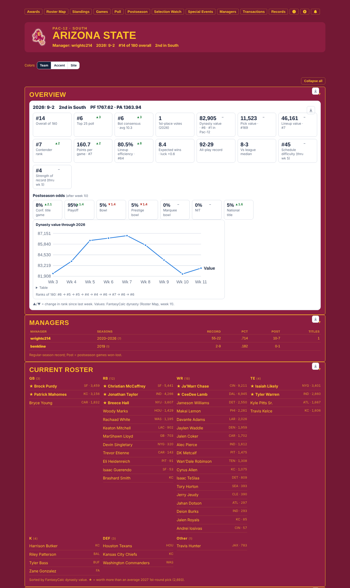
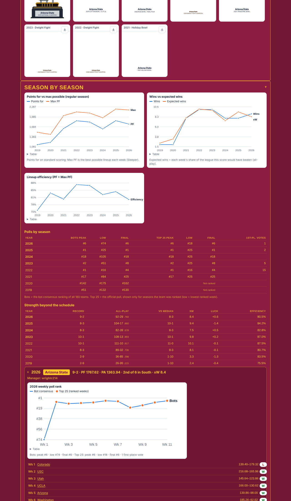
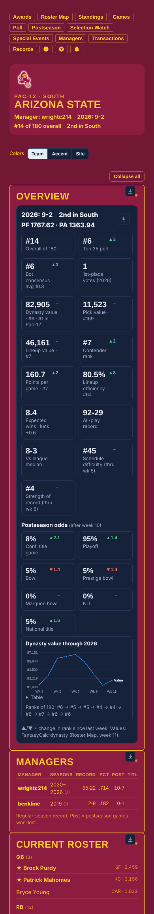

# 5.20 Team pages, round 2

**Remove this file and `docs/reviews/5-20b-team-pages/` at merge.**

## What changed
- **No real names.** Draft history now marks reconstructed drafts with ‡ and the footnote "Reconstructed, not from Sleeper data; pick order may not be exact." Every team-page source file is reworded to use the role ("league data"). A test fails if a real name comes back.
- **Overview card**, first section, with its own Save image button. Current teams only; defunct teams have no card.
  - Header line: record, division place, PF/PA.
  - Tiles, with ▲/▼ change since last week wherever a previous week exists:
    - overall rank of 180
    - Top 25 poll rank, bot consensus rank and average bot rank, first-place votes
    - Roster Map ranks: dynasty value (also its rank within the league), pick value, lineup value, contender, PPG, lineup efficiency
    - expected wins and luck, all-play record, record vs league median
    - schedule difficulty and strength of record
  - Postseason: the team's games once it has one. Until then, the Selection Watch odds (CCG, Playoff, Bowl, Prestige, Marquee, NIT, national title) with the change from the previous odds file.
  - Next game: win chance and projections, shown during the postseason only for the team's real game.
  - Dynasty value trend for this season, with the rank each week.
- **Managers:** each Sleeper user who ran the roster, grouped by user ID so a username change stays one manager. Seasons, regular-season record and win %, postseason W-L, titles.
- **Current roster:** sorted by FantasyCalc dynasty value, value shown. ★ marks anyone worth more than an average next-draft 1st (FantasyCalc's plain 1st-round value; 2,693 for 2027 today).
- **Draft picks:** the orphan card's pick list (`orphan_card.assets`): best 4 owned picks by value with "via" for acquired picks, plus the total owned.
- **Season by season:**
  - Charts: PF (standard) vs Max PF, wins vs expected wins, lineup efficiency.
  - Tables: polls by season (bot consensus peak/low/final, Top 25 peak/low/final only for seasons the team was ranked, first-place votes) and all-play / vs median / xW / luck / efficiency.
  - Each season block has a weekly poll chart: the bot consensus line plus dots for the weeks the team was in the official Top 25.
  - All charts are SVG on one axis, with a legend, end labels, a hover/tap tooltip and a table view. Colours are dataviz categorical slots 1–2, validated for light and dark.
- **Head to head:** all-time record vs every team the roster has played, regular season and postseason, linked to their pages.
- **Team picker:** My team at the top, read from this device's app pick or its first followed team. "Set your team" links to the app page when none is set.

- **Team colours, three ways:** a toggle under the header (Team / Accent / Site). Each device remembers the choice for every team page.
  - **Team (default):** sections in the team's colour, headings in the accent colour. The accent is the team's secondary colour when it reads at 3:1 on the background, else the text colour. The season name label is inverted (text colour on the background) so it stands off the block. W/L sits in neutral pills. The overview card, charts, trophies and trade cards stay on neutral panels, so status colours and grades always read.
  - **Accent:** team-coloured heading bars and accent edge on a lightly tinted page.
  - **Site:** the site's own colours.
  - The colours sit in a `<style>` element, so saved images keep them.

## Data notes
- **Schedule difficulty is stale:** `ScheduleDifficulty_Season.csv` only has through week 5, and the tiles say so.
- **Odds are a week behind:** `reports/postseason/odds.json` is after week 10, so there's no week-11 odds file yet.
- **Max PF** uses Sleeper's best lineup scores (`LineupWeeks_Historic.csv` "Best", `MaxPoints_Season.csv`). Efficiency is Sleeper PF ÷ Max PF.
- **Expected wins and all-play** are computed on the standard scores shown on the page. They differ from the Standings files' "Exp Wins" by hundredths.
- **Next-game projections** have one row per game, so the opponent's side is filled in by flipping it.

## Tests
- Python: 366 passed. JS: 88/88. Team, menu and trophy browser suites pass.
- New checks:
  - overview fields
  - roster sort and stars
  - picks count
  - Max PF above PF
  - all-play = 11 × 11 per season
  - poll final matches the last week
  - manager totals match the seasons
  - head-to-head totals match the games
  - defunct teams have no current data
  - chart tooltip
  - My team card
  - colour toggle (three modes, remembered, label inverted)
  - no real names

## Screenshots (Arizona State)

