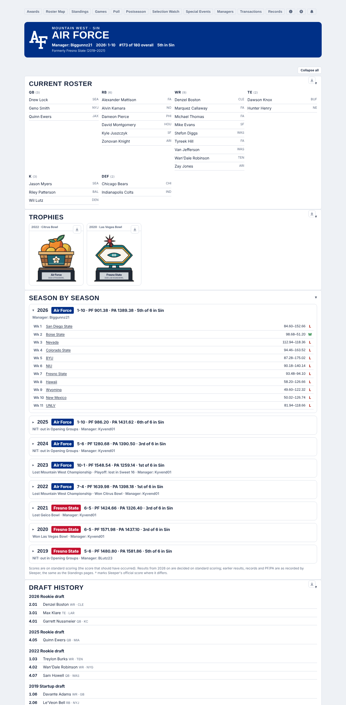
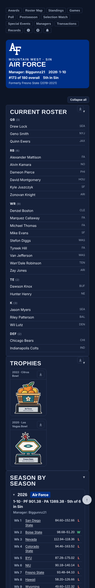
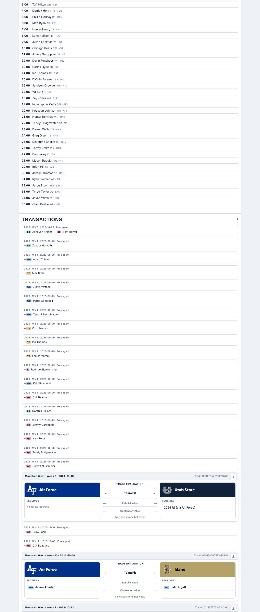
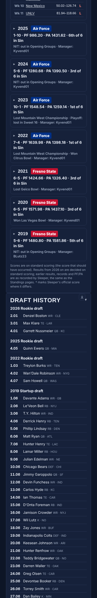

# 5.20 Team pages, stage 1

**Remove this file and `docs/reviews/5-20-team-pages/` at merge.**

## What I built

**One template page, filled in the browser.** `reports/team.html?league=<current league id>&roster=<id>` reads `data/teams/<league slug>-<roster>.json`. There are no prebuilt per-team pages.

- **`scripts/team_pages.py`** writes the 180 team files, `data/teams/index.json` and the `team.html` shell.
  - Files are named by league **name** plus roster, so they don't move when Sleeper league IDs change.
  - A file is only rewritten when its content changes. A team that leaves the league has its file deleted.
  - It is in the weekly `update-leagues.yml` run as `team_pages`, after trophies, transactions_page, standings_page and postseason_page. `git add data/teams` is in the commit step.
- **`reports/assets/team.js`** draws the page:
  1. **Header:** current name, logo and colours, league · division, manager (Sleeper username), this season's record, overall rank, division place and former names.
  2. **Current roster**, grouped by position.
  3. **Trophies:** the shared `NCAATrophy.html()` component, which is the JS twin of `trophy_html()`. Each trophy has its own Save image button. Newest first. If there are none, one line says so.
  4. **Season by season:** collapsible, newest first, with the current season open. Each block shows that season's name (with that season's colours when it differs), record, PF/PA, division finish, a one-line postseason result, the manager that season, and the week-by-week regular season plus that season's postseason games. Opponents link to their own team page.
  5. **Draft history:** grouped by year. Startup drafts and rookie drafts are labelled. Picks from Chris's sheets are marked.
  6. **Transactions:** newest first, 25 at a time with a "Show more" button.
     - Trades are the Transactions page's own card (`transactions_page.trade_card()` with its grades and Team Fit), pre-rendered into the JSON.
     - Adds and drops are rows using the Transactions page's position badges.
- **`reports/assets/team-link.js`** holds the season matching (JS twin of the Python functions) plus link building. See "Calls I made" for the link rule.
  - Opening `team.html` with a past season's league ID resolves to this season's team and rewrites the URL. Old links keep working after each rollover.
  - `team.html` with no query shows a team picker. A retired roster (2019 American, 2020 Southland) shows the picker with a message.
- **Links:** team names on the current and past Standings pages and on the Games page matchup header (both team blocks, regular-season and postseason views). Not linked yet:
  - the Games overview list (`scoreboard-overview.js`)
  - Awards, Poll, Postseason/bracket, Transactions cards, Records, Managers, Roster Map, Selection Watch, Special Events
- **Nav:** `config/nav.json` now has a `team` tab ("Teams", `team.html`, `hidden-dev`). The menu has been rebuilt.
- **Settings:** `config/team_pages.json` has `_note` keys and safe defaults: position order, transactions per page, the round count that marks a startup draft, and whether the current season starts open.
- **Mobile first:** I checked at 390 px and found no sideways scroll; the browser test asserts this. The standard folds, Collapse all and Save image are loaded after the page is drawn, so every section and card gets its button.

## Tests
- `tests/test_team_pages.py`: season matching, settings, and a full build against the repo's data.
  - Renamed school: Mountain West roster 4, Fresno State until 2021 and Air Force from 2022, with its Fresno State trophy kept.
  - Manager change on the same roster.
  - Seasons where the roster didn't exist: Ohio Valley starts in 2021; Big Sky and Pioneer have no 2019 season.
  - Every 2021–2026 record, PF and division place matches the Standings files (1,080 rows, 0 mismatches).
- `tests/team-link.test.js`: the same cases from the shared `tests/fixtures/team_link_cases.json`, plus the link-visibility rule.
- `tests/test_team_pages_browser.py` (added to `pr-check.yml`):
  - loads the page on desktop (light) and mobile (dark), checks every section and the trophy art
  - checks that a past league ID redirects, and the picker and retired-team message
  - checks that Standings links appear only with Dev view on and land on the right team
- **Results:**
  - Python: 356 passed, 1 failed. The failure is `test_color_literals` on `reports/assets/selection-watch.js:134`. I didn't touch that file; the failure is already in the starting commit.
  - JS: 86/86 passed.
  - Menu, scoreboard (all three) and trophy browser suites: passed.

## Data I couldn't find or that looked wrong
- **2020–2021 rookie drafts** exist only where Chris's sheets cover them: 2020 Wild, Big Ten and Pac-12; 2021 Big Ten plus one league from Sleeper. Every other league shows no rookie draft for those years.
- **2022 Big Ten rookie draft:** the draft is in `Drafts_Historic.csv` but has 0 picks in `DraftPicks_Historic.csv`.
- **2019–2020 records:** `data/backfill/Standings_2019_2020.csv` has Sleeper's 15–17-game totals. The team page uses the real 11-week regular season from the matchups (`IsRegularSeason`).
- **Trophies with no team page:** 7 belong to retired leagues (2019 American: Ohio, Cincinnati, Miami (OH); 2020 Southland: Dixie State, Lamar, Nicholls State, Presbyterian). They are on no team page.
- **Trades:** A few trades aren't two-team trades (12 team entries across all files), so the Transactions card can't draw them. They show as plain rows (partner, gets, gives). Some two-team trades list one side receiving nothing, such as Air Force–Utah State on 2024-10-10. That comes straight from Sleeper's `Picks` data.
- **Grades on old trades:** before this season they show "No values from that week" because `PlayerValues_Season.csv` and `PickValues_Season.csv` only hold this season's FantasyCalc values.
- **Player names:** older players come from `data/backfill/PlayerPositions_All.csv` (`Players.csv` only has about 900 current players). Every add/drop resolved to a name.

## Calls I made
- **Which scores show:**
  - Week rows show the **standard-scoring** score (your rule: the score that should have occurred), with "† Sleeper: x–y" where it differs.
  - Before 2026 the **result, record and PF/PA are Sleeper's official ones**, so they match the Standings pages. 30 past games (60 team rows) carry a note that standard scoring would have flipped them while Sleeper's result stands.
  - From 2026 on, results are decided on standard scoring, the same as the Standings page.
  - One knock-on: a past season's PF in the header line is the official total, so it won't equal the sum of the standard scores in the rows. Say if you'd rather the season line use standard totals too.
- **Division finish** uses the `standings.py` rule (wins with ties as half, then PF, ties share a place). It matches every Standings file.
- **Postseason line:** the last game of each event, e.g. "Lost Mountain West Championship · Playoff: lost in Sweet 16" or "NIT: out in Opening Groups". The current season's games come from `Postseason_Season.csv` and show "pending" until final.
- **Links follow the nav state** rather than always showing. A plain link on Standings and Games would have exposed a Dev-only page to everyone. The links appear only when the page itself would: Dev view on while it's `hidden-dev`, and for everyone once you set the tab to `visible`, with no page rebuild needed.
- **Trades in each team file:** I pre-rendered the Transactions page's cards into each team's JSON instead of rewriting them in JS. That keeps the rendering and grades identical, but transactions are most of the size: 15 MB raw for all 180 files, about 85 KB per team and 22 KB gzipped on the wire for the biggest. Weekly runs rewrite only the files that changed.
- **Trophy order:** newest season first, then title, playoff round, CCG, NIT, bowl, special events.
- **Not built:** manager pages, My Team cards, the trophy room redesign and league pages, as the prompt says.

## Screenshots
Mountain West roster 4 (Air Force, formerly Fresno State).

| Desktop (light) | Mobile 390 px (dark) |
|---|---|
|  |  |
|  |  |
