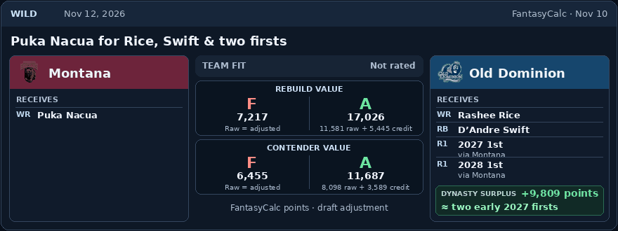
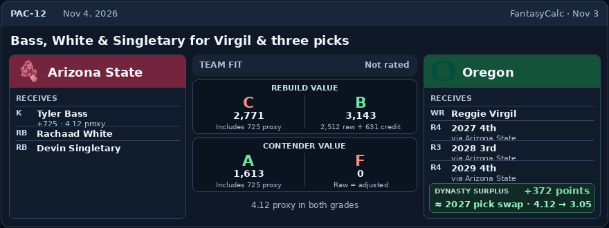

# Task 5.11 Transactions — developer / auditor handoff (TEMPORARY; DELETE BEFORE MERGE)

> **Status:** Draft PR #111 has the dynasty concentration replacement and Team Fit v1 implemented for review. The three mockups are historical design references, not current grading results. Keep this README and all three mockups on the review branch. At merge time, the merge agent pins review links, removes the temporary files, and reruns checks on the exact landing commit. Do **not** merge or deploy from this branch.

## Active review working list

This list reconciles the earlier review with subsequent owner decisions. It takes precedence over the original brief and the earlier review examples below where they conflict. Unchecked tasks remain open. The model and market regression checks are recorded below.

- [x] **Replace the inverted consolidation credit.** Dynasty now uses the approved [60% concentration model](#dynasty-concentration-decision), Contender uses raw totals, and grades and pick-equivalent surpluses were regenerated. Raw Blockbuster eligibility and Team Fit were not changed. The model bounds each side’s penalty by 60% of its eligible raw value. No additional fixed winner-flip limit was selected.

- [x] **Build Team Fit v1.** See [the model and review cases](#team-fit-v1). It uses independently calibrated goal-based units rather than the draft 50/50 market-grade normalization. Wins/odds projections and the narrative remain unavailable.

- [ ] **Refresh the Sleeper player list.** UNC Charlotte's roster includes Sleeper player ID `1348` before and after the Walker–Achane trade. It is absent from the traded-player catalog and market snapshots. The official Sleeper player feed confirmed it is Dustin Hopkins, a kicker. The dedicated biography table now resolves his position without rewriting historical market values. Refresh the main `data/Players.csv` as separate maintenance if needed. Per the owner, unresolved roster player IDs count as zero in both Team Fit value components and do not block a grade on their own. Use the 4.12 proxy only for confirmed K/DST entries. Use a plain hyphen (`-`) in the grade slot when the roster or required historical snapshots cannot be established.

- [x] **Keep approved scope and document K/DST scarcity.** The permanent docs record the 4.12 rationale: the pool is fully rostered, undrafted rookie kickers go quickly, and a weak rookie kicker costs about a fourth. The proxy is not a FantasyCalc quote. Win/odds rows remain unavailable and on-page narratives are deferred.

- [x] **Keep the shared menu generic.** Removed the ID-specific fallback for label, link and state. The configured Transactions entry is explicitly `hidden-dev`. Missing entries or entries without a label or link are omitted. A complete entry without state uses the generic `visible` default.

- [x] **Dedicated settings.** Transactions and FantasyCalc settings already moved out of `config/league.json` to `config/transactions.json`. **Superseded cleanup request:** keep all 16 existing display labels. The owner reviewed and accepted them after the earlier note. Shared week labels already come from the league helper.

- [x] **Generalize the PR workflow.** `pr-check.yml` runs on all pull requests with read-only contents permission. It still checks the committed menu before any report generation, runs the full Python and Node suites, and generates the preview and browser artifact.

- [ ] **Final integration and handoff.** Fetch current `main` before final review. The owner plans #111 before #109, and #109 was still unmerged when this list was added. If #109 lands first, rebase on updated `main`, reconcile the menu sources, then regenerate `reports/assets/menu.js` with `scripts/menu_build.py` and verify no freshness diff. Record each completed fix, setting file/key/default, and tests **written** versus tests **actually run** and results for the exact review SHA. Keep this README and all three mockups for the merge agent. Keep the menu `hidden-dev`. No merge, deployment, public announcement, or Discord posting from this branch.

## Current implementation / review checkpoint

- Generator: `scripts/transactions_page.py`; generated preview: `reports/transactions.html` (regenerated and committed **only to the feature branch**).
- Pure grade/slot approximation engine: `scripts/transactions_grades.py`; configurable thresholds and dynasty concentration: `config/transactions.json` under `transactions`.
- Historical picks: `data/PickValues_Season.csv` backfilled from eight verified Git commit revisions on Oct 2, 6, 13, 20, 27 and Nov 3, 10, 17. Future capture: `scripts/player_values.py`; workflow step in `.github/workflows/update-leagues.yml`.
- Nav: `config/nav.json` entry `hidden-dev`; menu compiled by the existing weekly `scripts/menu_build.py`. **Do not gratuitously edit `templates/menu.js` or `reports/assets/menu.js` during accessibility PR #109.** The generated menu is committed. Read-only CI regenerates it and requires no diff before testing normal vs. Dev navigation.
- Tests: `tests/test_transactions_page.py` and `tests/transactions_browser.py`. General PR CI `.github/workflows/pr-check.yml` is read-only: runs the full Python suite, every Node test, static generation, and Chromium desktop/light and mobile/dark smoke checks, then uploads HTML + two viewport screenshots as the Actions artifact `transactions-preview`.
- Final review build contains **113 trades, 34 Rebuild-graded, 11 weeks, 15 conferences, and 4 Blockbuster badges**. Check the latest read-only Actions run on this draft PR for the full test and browser results.
- The [review data](#reproduced-review-grades) lists current market grades, Team Fit and why each team's results check out.
- **Known limitation:** Team Fit uses a hyphen when trade-time evidence is insufficient. Projected wins and before/after odds are not calculated. The explanations here are reviewer notes, not a new site feature.
- Cards disclose raw market totals and the spread penalty. Pick equivalents are interpolated, not exact FantasyCalc slot quotes.
- The generated preview page embeds dated trade data. Rerun the generator when upstream snapshots change; do not silently treat the committed preview as live data.

## Dynasty concentration decision

**Use a 60% concentration adjustment for dynasty grades.** The owner setting is `config/transactions.json` → `transactions.consolidation.dynasty_concentration_rate` (default `0.60`), used by the `asset-concentration` method. This replaces the experimental KTC-style balancing credit. Set the method to `none` to use raw totals. Contender always uses raw rest-of-season values, with draft picks worth zero and no concentration adjustment.

For each side, take the nonnegative trade-date market values `v_i` of the assets it receives. Let `P` be any K/DST proxy points. They still count toward the total but are excluded from the concentration calculation.

```text
Market total          T = sum(v_i)
Concentrated value    C = sqrt(sum(v_i^2))
Spread penalty        D = T - C
Raw value             R = T + P
Adjusted value        A = R - rate * D
                        = P + (1 - rate) * T + rate * C
```

Compare the two independently adjusted totals. The consolidation edge is the difference between the applied penalties, in favor of the side with the smaller penalty. It is not a separate bonus to add to the already adjusted score. No elite cutoff, asset-count cutoff, or waiver-spot credit is used. For a rate from 0 to 1, adding a nonnegative asset cannot lower either the sum or the square-root term, so it cannot lower that side's adjusted value or change the other side's score. A single asset has no spread penalty.

At 60%, one 90-point asset stays at 90. Three 30-point assets also total 90 raw, but their concentrated value is about 52, so their adjusted total is about 67. Adding a 2-point throw-in to the single asset raises its adjusted total to about 90.8. The throw-in never erases the consolidation edge just because the piece count changes.

### Why 60%

We treated every completed deal as if it were fair for calibration, then minimized the **mean absolute adjusted gap** across the **34 of 113** two-sided completed trades with usable trade-date dynasty snapshots. The loss was `mean(abs(A_side_1 - A_side_2))`. Measuring absolute gaps prevents gains and losses from canceling. The fit used the dated snapshots rather than the live calculator screenshots, including Maye's pre-injury valuation.

| Rate | Mean absolute gap from even |
| --- | ---: |
| 0% | 996 points |
| 25% | 919 points |
| 50% | 876 points |
| 53.2% (best fit) | 872 points |
| **60% (selected)** | **879 points** |
| 70% | 890 points |

60% gives more weight to concentrated value than the mathematical optimum and costs only about seven points per trade in average fit. We preferred that stronger effect to claiming false precision from a small sample and a deliberately imperfect equal-trade assumption. At 60%, on the historical inputs, Walker's side leads by about 270, the Maye pick package leads by about 581, and the Rice/Swift package leads Puka by about 963.

FantasyCalc's live waiver adjustment was a comparison, not a calibration target. Adding three positive-value throw-ins to Puka removed the waiver credit and widened the live calculator's gap. The regression test uses that before/after to guard the replacement model. Raw Blockbuster thresholds are separate and should not change.

## Task 5.11 owner settings

This lists every owner setting introduced or moved by this PR, including the settings already present in the earlier draft. The dedicated config has three sections, `transactions`, `fantasycalc`, and `team_fit`. Defaults apply when the file, a section, or an individual key is absent. The static generator embeds the resolved settings in the generated page. Rebuild it after changes. If the tab is removed entirely it is omitted from the menu, while the direct URL is still accessible. Menu visibility is not access control. No new secrets or external repo variables are required.

The existing shared brand, conference terminology, and semantic colour tokens are reused. Team colours and names still come from CSV data. No separate transaction-specific theme or release switch is introduced. When changing FantasyCalc scoring format, check that the stored history remains comparable. If the draft field size changes, select a proxy slot that exists in that field.

| File | Key | Default |
| --- | --- | --- |
| `config/transactions.json` | `transactions.consolidation.method` | `"asset-concentration"` |
| `config/transactions.json` | `transactions.consolidation.dynasty_concentration_rate` | `0.60` |
| `config/transactions.json` | `transactions.rebuild_grade_caps` | `[[10, "C-", "C+"], [20, "D+", "B-"], [30, "D", "B"], [40, "D-", "B+"]]` |
| `config/transactions.json` | `transactions.grade_bands` | `[[60, "A"], [55, "B+"], [52, "B"], [48, "Even"], [45, "C"], [40, "D"], [0, "F"]]` |
| `config/transactions.json` | `transactions.blockbuster_min_multiple` | `1.4` |
| `config/transactions.json` | `transactions.blockbuster_min_headliner_share` | `0.6` |
| `config/transactions.json` | `transactions.proxy_pick_slot` | `"4.12"` |
| `config/transactions.json` | `transactions.surplus_swap_max_relative_error` | `0.25` |
| `config/transactions.json` | `transactions.draft_slots_per_round` | `12` |
| `config/transactions.json` | `transactions.draft_tier_anchors` | `[2, 6, 10]` |
| `config/transactions.json` | `transactions.movement_types` | `["free_agent", "waiver", "commissioner"]` |
| `config/transactions.json` | `transactions.labels.rebuild` | `"Rebuild"` |
| `config/transactions.json` | `transactions.labels.contender` | `"Contender"` |
| `config/transactions.json` | `transactions.labels.blockbuster` | `"Blockbuster"` |
| `config/transactions.json` | `transactions.labels.surplus` | `"Dynasty surplus"` |
| `config/transactions.json` | `transactions.labels.team_fit` | `"Team Fit"` |
| `config/transactions.json` | `transactions.labels.evaluation` | `"Trade evaluation"` |
| `config/transactions.json` | `transactions.labels.trades` | `"Trades"` |
| `config/transactions.json` | `transactions.labels.movement` | `"Player movement"` |
| `config/transactions.json` | `transactions.labels.summary` | `"Season summary"` |
| `config/transactions.json` | `transactions.labels.receives` | `"Receives"` |
| `config/transactions.json` | `transactions.labels.most_added` | `"Most added"` |
| `config/transactions.json` | `transactions.labels.most_dropped` | `"Most dropped"` |
| `config/transactions.json` | `transactions.labels.team` | `"Team"` |
| `config/transactions.json` | `transactions.labels.pick` | `"Pick"` |
| `config/transactions.json` | `transactions.labels.pick_swap` | `"Pick swap"` |
| `config/transactions.json` | `transactions.labels.trades_by_week` | `"Trades by week"` |
| `config/transactions.json` | `fantasycalc.url` | `"https://api.fantasycalc.com/values/current"` |
| `config/transactions.json` | `fantasycalc.dynasty` | `true` |
| `config/transactions.json` | `fantasycalc.num_qbs` | `1` |
| `config/transactions.json` | `fantasycalc.num_teams` | `12` |
| `config/transactions.json` | `fantasycalc.ppr` | `1` |
| `config/transactions.json` | `fantasycalc.timeout_seconds` | `30` |
| `config/transactions.json` | `fantasycalc.minimum_player_rows` | `100` |
| `config/nav.json` | `tabs[id=transactions].label` | `Transactions` |
| `config/nav.json` | `tabs[id=transactions].href` | `transactions.html` |
| `config/nav.json` | `tabs[id=transactions].state` | `hidden-dev` |

## Team Fit v1

Team Fit is not the market trade grade. Each team is evaluated independently against keeping its pre-trade roster. It uses the latest eligible pre-trade weekly context, pre-trade FantasyCalc values, and an archived roster/pick rewind checked by forward replay. A later archive is used only to verify ownership, never to supply forecasts or prices. Git publication time bounds what can be known. The most recent trades may remain ungraded until a second archive corroborates them. Insufficient evidence displays a hyphen. Unknown IDs otherwise count as zero.

- Win now measures change in the best legal starting lineup. The specialist input recognises scarce starter coverage from prior scoring. It does not change the 4.12 market proxy.
- Future value compares the return with holding through both rebuild windows. Projected retention applies incremental, position-specific age decline (gradual and steep stages). For rebuilders, picks are flexible capital at a configurable utility premium, not guaranteed starters. Future lineup capacity rewards usable players at multiple slots. When pick capital increases, do not also charge the seller as if that capital were guaranteed to go unused.
- Before the deadline week ends, negative lineup changes are progressively neutralised for teams with weak contender evidence. The weight blends pre-trade record, contender index and eligible published playoff/bowl odds. Bowl odds count less and even a strong contender retains some future weight. No permanent team tag or manager intent is inferred.
- Fit = 50 + 20 × weighted net gain in meaningful-impact units, clipped to 0–100. Use the existing grade bands. The team-details disclosure shows trade-date lineup and dynasty totals, hold-comparison points for both horizons, and differing horizon letters. The archive contains no verified pre-trade bids, so no hypothetical offer counts.
- These settings were calibrated on the review examples, not fitted to force the league-wide score distribution toward 70 or independently validated. The roster biography seed comes from the [Sleeper player catalog](https://api.sleeper.app/v1/players/nfl). It stores IDs, position and birth dates, not current injury flags.

| Review case | Team | Win-now weight | Lineup before → after | Raw dynasty before → after | Fit |
| --- | --- | ---: | ---: | ---: | ---: |
| Gibbs | Brown | 65% | 33,464 → 40,387 | 87,700 → 88,451 | A · 65.6 |
| Gibbs | Bucknell | 9% | 25,335 → 19,610 | 57,369 → 56,618 | B · 52.9 |
| JSN / A.J. Brown | Brown | 70% | 41,036 → 47,724 | 88,988 → 92,472 | A · 68.2 |
| JSN / A.J. Brown | Penn | 22% | 19,804 → 7,316 | 57,119 → 53,635 | Even · 50.7 |
| Walker–Achane | Citadel | 39% | 27,151 → 18,325 | 65,901 → 68,009 | Even · 51.1 |
| Walker–Achane | UNC Charlotte | 70% | 28,972 → 36,592 | 65,463 → 63,355 | A · 63.2 |
| Puka | Montana | 64% | 49,525 → 49,786 | 90,763 → 86,399 | C · 45.0 |
| Puka | Old Dominion | 70% | 47,078 → 47,477 | 89,821 → 94,185 | B+ · 55.5 |
| Bass / White / Singletary | Arizona State | 70% | 45,143 → 45,392 | 90,786 → 91,045 | B · 52.2 |
| Bass / White / Singletary | Oregon | 10% | 10,837 → 9,826 | 50,688 → 50,429 | B+ · 55.1 |

**Tests written:** age curves and the RB cliff, valid below-market sales versus holding, relative bowl weight, hyphen for missing coverage, and the five archived reference grades. **Tests run locally:** full Python suite (152 passed, 10 skipped), full Node suite, deterministic menu rebuild, and report generation. The model produced 68 team-side grades and 158 ungraded sides. The modal letter remains Even (27 of 68 scored sides). Those are the preceding Fit-only test results. The market recheck below did not change the Fit output.

### Team Fit owner defaults

| File | Setting | Default |
| --- | --- | --- |
| `config/transactions.json` | `team_fit.meaningful_lineup_points` | `6500` |
| `config/transactions.json` | `team_fit.meaningful_future_points` | `4500` |
| `config/transactions.json` | `team_fit.score_points_per_unit` | `20` |
| `config/transactions.json` | `team_fit.record_weight` | `0.7` |
| `config/transactions.json` | `team_fit.playoff_context_weight` | `0.25` |
| `config/transactions.json` | `team_fit.bowl_weight` | `0.15` |
| `config/transactions.json` | `team_fit.odds_first_week` | `8` |
| `config/transactions.json` | `team_fit.win_now_ceiling` | `0.7` |
| `config/transactions.json` | `team_fit.rebuild_lineup_grace_through_week` | `10` |
| `config/transactions.json` | `team_fit.rebuild_lineup_full_weight_at` | `0.48` |
| `config/transactions.json` | `team_fit.rebuild_lineup_no_weight_at` | `0.28` |
| `config/transactions.json` | `team_fit.rebuild_starter_weight` | `0.9` |
| `config/transactions.json` | `team_fit.future_starter_floor` | `1300` |
| `config/transactions.json` | `team_fit.future_starter_cap` | `4500` |
| `config/transactions.json` | `team_fit.rebuild_max_weight` | `0.38` |
| `config/transactions.json` | `team_fit.growth_horizon_years` | `[1, 2]` |
| `config/transactions.json` | `team_fit.pick_flexibility` | `0.42` |
| `config/transactions.json` | `team_fit.specialist_lookback_weeks` | `4` |
| `config/transactions.json` | `team_fit.specialist_target_ppg` | `8` |
| `config/transactions.json` | `team_fit.specialist_needs_points` | `2600` |
| `config/transactions.json` | `team_fit.age_curves` | `{"QB": [31, 0.07, 35, 0.2], "RB": [27.5, 0.15, 30.5, 0.4], "WR": [28, 0.1, 31, 0.28], "TE": [29, 0.09, 32, 0.25]}` |

## Reproduced review grades

Dynasty shows raw → adjusted points with the market grade. Contender shows raw rest-of-season points and its market grade. Team Fit is the independent grade vs. holding. Values are rounded for display. The rationale describes what the teams gained or gave up using trade-time evidence, not what their managers intended.

| Trade (Sleeper ID) | Team receiving | Dynasty raw → adjusted | Contender raw | Team Fit |
| --- | --- | ---: | ---: | ---: |
| Lamb `1426087744886558720` | Georgia Tech | 9,467 → 8,503 (A) | 9,235 (A) | 68.49 (A) |
| | Virginia Tech | 6,721 → 5,175 (F) | 777 (F) | 37.26 (F) |
| Maye `1425929791147610112` | Maine | 6,334 → 4,791 (B) | 0 (F) | 69.68 (A) |
| | Youngstown State | 4,210 → 4,210 (C) | 3,047 (A) | 50.73 (Even) |
| Gibbs `1412325964028899328` | Brown | 11,017 → 11,017 (A) | 10,825 (A) | 65.63 (A) |
| | Bucknell | 10,266 → 7,325 (F) | 5,371 (F) | 52.85 (B) |
| JSN / A.J. Brown `1414580639092518912` | Brown | 14,328 → 11,848 (A) | 12,912 (A) | 68.20 (A) |
| | Penn | 10,844 → 7,104 (F) | 424 (F) | 50.74 (Even) |
| Walker `1425239682513420288` | ETSU | 6,869 → 6,869 (B+) | 9,421 (A) | 64.60 (A) |
| | Charleston Southern | 7,424 → 5,347 (D) | 0 (F) | 61.01 (A) |
| Bass / White / Singletary `1423799198175739904` | Arizona State | 2,771 → 2,463 (B+) | 1,613 (A) | 52.16 (B) |
| | Oregon | 2,512 → 1,866 (D) | 0 (F) | 55.07 (B+) |
| Walker / Achane `1425957598431035392` | Citadel | 9,015 → 6,637 (Even) | 0 (F) | 51.05 (Even) |
| | UNC Charlotte | 6,907 → 6,907 (Even) | 9,310 (A) | 63.20 (A) |
| Puka `1426656560473452544` | Montana | 7,217 → 7,217 (C) | 6,455 (D) | 45.03 (C) |
| | Old Dominion | 11,581 → 8,180 (B) | 8,098 (B+) | 55.50 (B+) |
| McCaffrey / Kittle `1426733052746272768` | Montana | 5,600 → 4,624 (D) | 2,888 (F) | 32.70 (F) |
| | South Dakota | 7,077 → 5,990 (B+) | 12,491 (A) | 48.27 (Even) |

### Why the grades check out

- **Georgia Tech** gained 7,818 in best-lineup value and 2,746 in raw dynasty value, making Lamb a strong move for a playoff push. **Virginia Tech** was 5–4 and still had a meaningful bowl chance. It lost 6,106 in lineup value, and its return fell short of holding at both future horizons. That is why the F in Fit agrees with the market result. Georgia Tech has a 3,329-point adjusted surplus, about 1.05. The concentration edge is 583 points and is already included, not a bonus on top. The previous model wrongly showed Virginia Tech ahead by 6,555.
- **Maine** was 2–5 and turned Maye into three picks while giving up just 114 in best-lineup value. The package beats holding in the future model and leads adjusted dynasty by 581 despite adding no current production. **Youngstown State** was 7–0 and gained 1,890 in lineup value, but surrendered enough future capital to make the move close to neutral in Fit. This uses historical inputs before Maye's later injury, not current calculator values. The market grade and Fit use their respective eligible November 10 and November 3 snapshots.
- **Brown** bought Gibbs and added 6,923 in lineup value, so the A in Fit agrees with the single-asset market win. **Bucknell** was 0–3 and acquired younger pass-catching talent and a second. That helps its nearer future even though the concentrated market price favors Brown and holding Gibbs remains competitive at two years.
- **Brown** added 6,688 in lineup value and 3,484 in raw dynasty value in the JSN/A.J. Brown trade, a strong return for a 3–1 team. **Penn** was 1–3 and got three firsts, a second, and younger depth. That creates flexibility, but keeping JSN was a credible rebuild option too. An Even in Fit can coexist with an F in market value.
- **ETSU** gained 8,033 in starting-lineup value with Walker and paid with future capital. The timing makes that an A in Fit. **Charleston Southern** got two firsts, a second, and a third. Its package loses on adjusted market price, but beats holding at both rebuild horizons, giving it an A in Fit too.
- **Arizona State** was 6–2 and filled an immediate kicker need with Bass while adding veteran depth. The market credits Bass at the 725-point 4.12 proxy, while Fit measures his coverage on this roster. **Oregon** was 1–7 and turned veterans and a spare kicker into future picks and a young player. It was 259 behind on raw dynasty price but improved versus holding. Arizona State leads adjusted dynasty by 598, about a 4.12 → 2.10 swap.
- **Citadel** got the larger raw dynasty package, but its current lineup lost 8,826 in value while it still had roughly a 53% bowl chance. Achane and Bell contribute zero in the trade-date rest-of-season snapshot. The future gain balances that cost in Fit. **UNC Charlotte** was 8–1 and gained 7,620 in lineup value by buying Walker. The A in Fit recognizes that improvement despite the future cost. The 270-point adjusted dynasty gap leaves both market grades Even, and the raw Blockbuster badge still applies.
- **Montana** added Puka but gained only 261 in best-lineup value and gave up 4,364 in raw dynasty value. That is a modest lineup gain for the price, hence the C in Fit. **Old Dominion** gained 399 in lineup value and took back two firsts, which gives it the better balance. Its 963-point adjusted dynasty surplus is about 3.12, not the two early firsts pictured in the old mockup.
- **Montana** was 5–4 with roughly a 50% playoff chance. McConkey and Hampton bring future upside, but giving up 10,090 in lineup value at that point makes this a poor trade-time fit. **South Dakota** gained 8,760 in lineup value, explaining the A in Contender. The return looks better than holding over one year than over two, making the overall Fit close to neutral. The actual raw Contender gap is 9,603 in South Dakota's favor, not Even.

### Market recheck on this revision

**Added coverage:** equal packages, one-for-many concentration, raw Contender and method-off defaults, penalty bounds, nonnegative throw-ins, proxy exclusion, real review fixtures, and browser regression checks for prominent market and Fit grades.

**Ran locally:** `python3 -m pytest -q tests` (160 passed, 10 skipped), all five `tests/*.test.js` files (29 passed), `python3 scripts/transactions_page.py` (113 trades, 34 graded), and `python3 scripts/menu_build.py` followed immediately by `git diff --exit-code -- reports/assets/menu.js` (clean). Regenerated cards retained identical Team Fit markup and the same four Blockbusters. Local Chromium could not start in the execution environment. Check the read-only Actions run for browser evidence on the review SHA.

### Small-trade Rebuild grade caps

The displayed Rebuild letter is clamped using combined **raw** dynasty points (including K/DST proxies) divided by the highest dynasty player value in the full eligible historical snapshot. The cap bands use exclusive ceilings. No cap applies at 40% or more. The raw and adjusted points, original score and surplus stay intact. Contender, Team Fit, Even, unavailable results and Blockbuster are unchanged. The tooltip discloses when a letter was capped.

Historical audit: 9 of 34 graded trades changed (16 letters), cutting A/F pairs from 10 to 5. Wisconsin–Ohio State (`1427749292088516608`) is 2,334 raw points, or 21.2% of the 11,017-point snapshot leader. Rebuild changes from A/F to B/D at the same 1,557–777 points. No historical graded trade fell below 10%. Synthetic tests cover that band and the exact 10%, 20%, 30% and 40% transitions, and the browser test checks Wisconsin’s rendered letters and values. Local checks: 170 Python passed (10 skipped), 29 Node passed, fresh menu rebuild, and regenerated report verified to change only 16 letters and their tooltips across nine cards.

### Menu and CI review recheck

The menu regression checks the actual Dev state, omission of missing or incomplete tabs, and config-owned label, link, and default state. No new owner settings. Rebuilt the menu, staged the generated bundle, and ran `python3 scripts/menu_build.py` immediately followed by `git diff --exit-code -- reports/assets/menu.js` with no unstaged diff. Local Python: 160 passed, 10 skipped. Local Node: 29 passed across all five suites. The regenerated Transactions report matched the checked-in report apart from the build timestamp. Use the general PR check on this revision for desktop and mobile browser evidence. Current `main` at `6b910b7` was already in this branch and did not contain #109.

## Trade-card design references

These three mockups use real completed trades. They are **design references, not screenshots of the current generator**. The two Montana cards use the existing draft grades. The Arizona State–Oregon card previews the agreed kicker/D/ST proxy and the proposed small-surplus pick-swap display.

### Montana–Old Dominion · Nov. 12, 2026



Trade `1426656560473452544`. **Blockbuster** at 18,798 combined raw dynasty points. The current card shows Old Dominion +963 (≈ Pick 3.12). The earlier mockup shows the superseded 9,809-point surplus.

### Montana–South Dakota · Nov. 12, 2026


Trade `1426733052746272768`. The current card shows a 9,603-point Contender advantage for South Dakota. The earlier mockup shows the superseded Even grade.

### Arizona State–Oregon · Nov. 4, 2026



Trade `1423799198175739904`. Bass is absent from the Nov. 3 market snapshot. He gets the historical **725-point 4.12 proxy** in both modes, excluded from the spread penalty. The current card shows **Arizona State +598**, approximately **4.12 → 2.10**, a value comparison rather than another term of the trade.

## Blockbuster acceptance set

Both tests use raw dynasty points measured against the most valuable player in the full historical FantasyCalc snapshot, not against the assets inside a deal. A trade must reach **1.40× combined** and include **one traded player at 60% or more**. Picks count toward volume, not the headliner. Consolidation and K/DST proxies count toward neither.

| Expected badge | Trade | Raw total | Headliner |
| --- | --- | ---: | --- |
| Yes | Brown–Penn (`1414580639092518912`) | 25,172 · 2.28× | Jaxon Smith-Njigba · 88% |
| Yes | Brown–Bucknell (`1412325964028899328`) | 21,283 · 1.93× | Jahmyr Gibbs · 100% |
| Yes | Montana–Old Dominion (`1426656560473452544`) | 18,798 · 1.71× | Puka Nacua · 66% |
| Yes | Citadel–UNC Charlotte (`1425957598431035392`) | 15,922 · 1.45× | Kenneth Walker III · 63% |

Montana–South Dakota and Arizona State–Oregon are still unmarked. The synthetic third-for-two-fourths case fails both tests. Another fixture passes the volume requirement with mid-tier players but fails the headliner requirement.

## Permanent project notes

The [Transactions project doc](docs/transactions.md) is the lasting record of the implemented scoring and display decisions, review examples, and open work. Keep it when removing this temporary README and its three design images. In particular, retain **“Why this trade makes sense”** as a deliverable for both teams, with roster context backed by evidence and inferred intent marked as such. The Team Fit grade is in review. Projected wins, before/after title/playoff/bowl/1.01 odds, and this narrative are **not implemented** here.

## Reviewer handoff prompt

> Independently review draft PR #111 against main. Do not merge it or deploy. Open the generated Transactions page and all three [design references](#trade-card-design-references), then use [the permanent Transactions doc](docs/transactions.md) as the specification.
>
> Reproduce the [review grades](#reproduced-review-grades), especially Tech–Tech, both Montana trades, Maye, Walker–Achane and Arizona State–Oregon. Verify each dynasty penalty independently and that positive throw-ins never reduce a side’s own adjusted value. Check raw Contender, the historical 725-point Bass proxy, the yearless Arizona State 4.12 → 2.10 surplus swap, and the four [expected Blockbusters](#blockbuster-acceptance-set). Confirm the grade labels and read the team-by-team rationale separately from the market prices.

### Review commands

```bash
python3 -m pytest -q tests
for f in tests/*.test.js; do node "$f"; done
python3 scripts/transactions_page.py
python3 scripts/menu_build.py
# Browser CI also runs: python tests/transactions_browser.py (requires Playwright + Chromium)
```

### Audit priority

1. **Valuation integrity:** explain every missing-history grade and every offset before Oct 2; inspect example 3's surprising zero RedraftValue player entries. Any historical trade without matching date snapshots stays ungraded.
2. **Team identity:** pick recipient roster from `owner_id`, original `via` owner from `roster_id`; confirm `NCAA180.myTeam()` matches conference short label + roster slot. No historical manager misattribution via `OwnerIDs`.
3. **UI:** compare current generated HTML + screenshots against user-approved dark-card concept. Desktop/mobile, keyboard, independent section folding, Save image, filter combinations, accessibility semantic colors `--good`, `--bad`, `--neutral`, neutral **grey**.
4. **Production safety:** hidden-dev menu, no Discord action, no main commits. The one-time preview publisher must **not** remain on branch; PR test workflow remains read-only.
5. **Merge gate:** resolve substantive audit issues and independently approve. The merge agent owns temporary file cleanup and exact-landing-commit validation. No automatic merge.


## Scope and boundaries

Build `reports/transactions.html` using `scripts/transactions_page.py`, from existing repository data only. Stage 1: trades, player movement, season summary. Stage 2: time-corrected FantasyCalc grades, draft-pick-equivalent surplus, and optionally substantiated team-context outcomes. **No Discord posts, webhooks, or extra Sleeper API pulls.** Nav entry must be `state: hidden-dev` in `config/nav.json`. Workflow: generate after `league_transactions.py` and `player_values.py` in `.github/workflows/update-leagues.yml`. Regenerate menu with `scripts/menu_build.py`.

**Safety:** branch from current main; never commit/push/merge directly to main. The independent reviewer decides readiness.

## Data contracts

- `data/Transactions_Season.csv` for 2026: `Year, LeagueID, LeagueName, Week, TransactionID, Type, RosterIDs, OwnerIDs, Picks, Adds, Drops, Status, Created, CreatorID`. Include **only `Status == complete`**.
- For trade assets, `Adds`/`Drops` map player ID → destination/source roster ID. Correctly reconstruct **who received** each player; validate both directions and uneven trades. `Picks` contain `season, round, roster_id` (original pick owner), `owner_id` (receiver), `previous_owner_id`. Pick display: `2027 R2 (via <original team>)`, using original-team identity, not the most recent holder.
- **Never attribute a historic trade to a manager using `OwnerIDs`**: these reflect owners at pull time. Use teams/roster identifiers and existing site identity helpers. No real names; only team names and permitted Sleeper display names.
- `data/Players.csv`: player identification. `data/Rosters_Current.csv`: **current** player ownership only, for movement availability. Team names, logos, colors and short conference names come from established `site_common` / site helpers.
- `data/PlayerValues_Season.csv`: `Date, Week, SleeperID, Name, Position, NFLTeam, DynastyValue, RedraftValue`; weekly FantasyCalc values back to **2026-10-02**. For a transaction choose latest snapshot with `Date <= transaction date` (UTC conversion from `Created` milliseconds, with a documented consistent date convention); **never** use later/current values as replacements.
- `data/PickValues_Current.csv`: `Season, Round, Value, Early, Mid, Late`. Backfill `data/PickValues_Season.csv` from dated historical Git versions of Current (starting on/after 2026-10-02, only where historical commit evidence exists), adding `Date`. Change `scripts/player_values.py` to append a dated pick snapshot on scheduled runs under the same date/week and manual-run safeguards as player snapshots. Ensure repeat runs are idempotent.
- If trade precedes all available snapshots, card states **“No values from that week”**, and **NO GRADE**. Do not silently use later snapshots, extrapolated historical values, or today's picks. Apply the explicit unlisted-asset rules in the permanent Transactions doc. If a required historical asset remains unresolved, expose incomplete coverage rather than presenting a confident false grade.

## Page layout / interaction

1. **Trades (first):** one card per completed trade, newest first. Header: conference short label, week, date. Both sides show logo, team name and **assets received** (players and original-owner pick label). Filters: conference, week, team. Highlight selected viewer team via `NCAA180.myTeam()`. Display valuation timestamp.
2. **Player movement:** week picker defaults to latest week. Separate *most added* and *most dropped* lists, sorted by distinct leagues affected. Count complete `free_agent`, `waiver`, `commissioner` adds/drops, **exclude trades**. Two pickups in the same league/week count once in “picked up in N leagues”; show ownership in N of 15 and **available in [short conference names]**, derived from latest `Rosters_Current.csv`, even when viewing an older movement week. Label this as **now owned** so it is not confused with historic ownership.
3. **Season summary:** completed trade counts by conference and week.
4. **All three sections fold independently; global Collapse all / Expand all; section-level Save image; data timestamp**. Support mobile, light/dark themes, accessible labels, focus, keyboard controls.

### Visual design approval

User approved the dark sports-dashboard mockup with colored team panels, prominent **Team Fit** letters, smaller **Rebuild Value** and **Contender Value** grades, a projected-wins row, team-context outlook boxes, and a **single value-surplus box on the side that gains**. **Do not copy the mockup's fictional data as real results.** No narrative “Why it works” footer in this PR; defer to a later PR.

For positive/negative/neutral **use accessibility tokens** from `reports/assets/menu.js` / `NCAA180.colors`, **not literal RGBs**. Existing `--good`, `--bad`, `--neutral`; neutral is **grey, not yellow**. Grades are derived from continuous internal numeric scores (proposed 0–100, neutral 50). For a continuous gradient, use the existing `NCAA180.colors.scale(score/100)` only after verifying its availability in the target branch; otherwise implement a local color interpolation using computed `--good`, `--bad`, `--neutral` semantic tokens. Never create an independent hard-coded letter→color lookup. Specific score→letter cutoffs and balancing rules belong in config and tests; distinguish comparative valuation scores from independent Team Fit scores. The previously specified comparative grade share bands are: >=60% A; 55–<60 B+; 52–<55 B; 48–<52 Even; 45–<48 C; 40–<45 D; <40 F. **Resolve and document the mapping** between these share bands and the proposed 0–100 display score/expanded A+…F visual scale before presenting as finalized; no silent contradictory grading systems.

Use these exact accessible light/dark tokens, by reference: light good #1a7f37, bad #b42318, neutral #6b7484; dark good #4fc785, bad #ff7b72, neutral #8a96ab. Use the currently available CSS semantic tokens directly; viewer-defined presets should work automatically once a future accessibility implementation updates those tokens. **Do not require the unimplemented accessibility settings API.**

### Four metrics (trade card)

1. **Team Fit** (largest): strategic value *for that actual team*, not an average of the other two grades. Both parties can score well or poorly. Assess accurate historical context before attributing a score.
2. **Rebuild Value** (small): FantasyCalc historical `DynastyValue` plus time-correct pick values, consolidation-adjusted. **Do not include tanking/draft-order benefit** here: that's context, not an asset exchanged.
3. **Contender Value** (small): historical `RedraftValue`; exchanged picks valued zero; separate from starting-lineup impact.
4. **Dynasty value surplus**, **only shown on the gaining team’s side**, including adjusted point surplus and **nearest next-draft rookie pick equivalent**. Clearly identify the recipient with logo/team name and arrow. No duplicate +/- surplus box on losing side.

**Draft-equivalent convention:** always the *upcoming draft relative to trade date* (2026 trades → 2027), with the year omitted from surplus labels. Below 4.12, show the closest meaningful same-draft swap anchored at 4.12, or points only. If surplus fits within a high first, use **one** nearest individual pick and accept rounding error. For surplus **above the value of a high first**, show a high first plus additional pick(s) as necessary. In a combination, the **main pick must be the highest-valued pick that fits** the surplus, even when a smaller initial pick plus a later pick would yield a numerically closer sum. Preserve exact FantasyCalc individual pick-slot data if the API returns it; currently stored historical/current pick CSV only retains round generic and early/mid/late tier values. If exact slots aren't available, interpolating within tiers is acceptable **only when visibly labeled approximate**; do not misrepresent inferred `2.07` as an observed FantasyCalc quote. If no meaningful pick match, report value delta without invented precision.

**Rebuild / contender math:** Use historical FantasyCalc, with the [approved concentration formula](#dynasty-concentration-decision) for dynasty and raw rest-of-season totals for Contender. Do not reuse the retired KTC-style credit.

**Projected wins:** user wants projected **rest-of-season wins gained/lost** from new players, not generic raw contender points. It must reflect replacement starters / lineup, byes and schedule, including a possible Week 13 RB2 hole that can make a seemingly unfavorable market-value RB trade critical. Preserve losses as negative values. For top-end contenders, meaningful title-odds change may justify an apparent overpay. For rebuilding teams, outlook should show **Bowl odds, 1.01 odds, and Projected Wins (ROS)** instead of title/playoff odds. For contenders, **Title odds, Playoff odds, and Projected Wins (ROS)**. Percentages are before→after with pp change; wins before→after with win difference. **Only render numeric claims when supported by reproducible historical matchup/roster/projection data and a validated forecast model**. Do not invent odds or wins to fill a layout. If historical source support is insufficient, defer/mark unavailable, and call out the limitation in the PR.

**Draft-order strategy:** NCAA 180 trade deadline is **end of Monday Night Football, Week 10**; rookie draft order uses **Week 11 standings** (per existing league rules). Trades legitimately made before the deadline may intentionally shed production and improve draft position; this strategic benefit belongs **only in Team Fit**. Evaluate expected draft-position distribution (not just P(1.01)); don't assume lower Max PF drives the draft order. Never use Week 11 results or later roster knowledge to grade what a manager knew at trade time.

**Time correctness:** historical standings / roster strength / odds must be evaluated *at trade time*, not the current Week 12 standing applied to an earlier decision. If data isn't available, **Team Fit must not claim fabricated certainty**. Realistic objective benchmarks may be explored in later PRs; current data-quality and technical limitations should be explicitly documented.

## Engineering / build sequence

1. Inspect current generators, CSV formatting, `site_common`, navigation, snapshot/save-image APIs and workflow. Confirm roster-ID vs team-name mapping, especially pick receiver fields.
2. Build independently tested pure parsing and aggregation functions; generate completed trade cards, filters, highlights; build movement & summaries.
3. Backfill pick history from historical commits **with evidence**; append future pick snapshots; implement historical value selector.
4. Implement pure, configurable rebuild/contender grading, consolidation inverse, draft-equivalent matching; log data coverage and ungraded trades.
5. Audit availability of historical projectable rosters, standings, projections and postseason odds **before** implementing team-fit/ROS-wins/odds. No retroactive leakage or fictional calculations.
6. Apply user-approved UI and shared accessibility colors; generate hidden-dev menu; wire weekly workflow.
7. Run/repair tests and inspect sample output; add **three actual 2026 trades**, including an uneven 3-for-1/2-for-1, to the PR description with raw totals, adjustments and both grades; never fabricate transactions or numbers.
8. Independent code/data/visual/a11y audit. Keep the review material on the branch for merge-agent cleanup. Do not merge yourself.

## Mandatory tests / review gates

Run and report actual outcomes, not assumptions:

```bash
python3 -m pytest -q tests
for test in tests/*.test.js; do node "$test" || exit; done
```

New tests must cover:
- Bidirectional players+picks attribution; 3-for-1 and 2-for-1 trades; original owner `via` label; no historical manager misattribution.
- Distinct-league movement add/drop counts; trade exclusion; `available in` short conference labels based on current roster.
- Snapshot on/before trade date (including same-day, missing before first snapshot, no future leakage); historical pick snapshot backfill and append idempotence.
- Grade boundaries/config mapping, symmetric comparative grading, zero-value assets, independent concentration penalties, monotonicity, and raw Contender.
- One next-draft pick only through high-first cap, highest-valued-fitting primary pick for larger surplus, approximate slot labeling.
- Team Fit independence and no fabricated odds/win improvements; deadline/Week 11 draft-order rule where applicable.
- Theme responsiveness, grade color from numeric score, keyboard navigation, fold and save-image controls.

PR body must list changes, changed files, test commands and statuses, risks/limitations, **three real and reproducible trade examples** with before/after grading math, manual validation steps, and reviewer decisions. Any unimplemented part must be plainly marked. The PR remains draft/not ready until engineering and tests complete.

## Concurrent PR #109 / accessibility integration note (2026-11-17)

PR #109 (Accessibility 5.8) is **draft and independently reviewed before merging**. It does **not** yet implement any new CSS tokens, JavaScript APIs or `localStorage["ncaa180.access"]` settings API. It changes existing `--up` and `--dn` declarations to reference `var(--good)` and `var(--bad)`, including dark-mode overrides. This Transactions implementation must use the established `--good`, `--bad`, `--neutral` tokens and avoid hard-coded red/green values. **Do not access or depend on `ncaa180.access`.** Its added GitHub Actions workflow is read-only PR testing and does not affect production deploys. Concurrent conflict-prone files: `templates/menu.js`, `reports/assets/menu.js`, `tests/menu.test.js`. Avoid unnecessary edits and rebase/revalidate carefully if #109 merges during development.

## Pending / future work

- Narrative explanations (“why it works”) expressly **deferred to future PR**.
- Discord integration **not in scope**.
- If audited historic data cannot support honest Team Fit / +wins / title, playoff, bowl and pick odds, document gap and plan a separate defensible model; do not substitute fantasy numbers.
