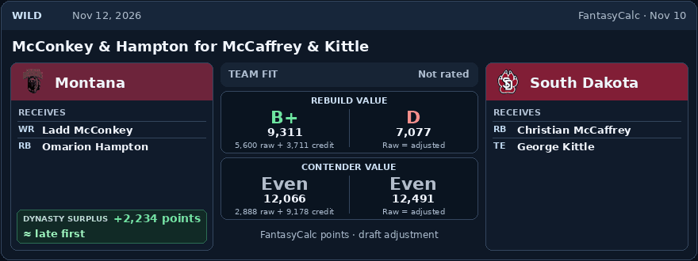

# Task 5.11 Transactions — developer / auditor handoff (TEMPORARY; DELETE BEFORE MERGE)

> **Status:** Implementation and review materials are ready for independent review on draft PR #111; **Team Fit and projected-win/odds context NOT implemented** because historical counterfactuals are not yet reliable. This file is intentionally committed for collaborators and independent review. Keep this README and all three mockups on the review branch. At merge time, the merge agent pins review links to the reviewed SHA, removes the temporary files, and reruns checks on the exact landing commit. Do **not** merge this PR automatically.

## Current implementation / review checkpoint

- Generator: `scripts/transactions_page.py`; generated preview: `reports/transactions.html` (regenerated and committed **only to the feature branch**).
- Pure grade/slot approximation engine: `scripts/transactions_grades.py`; configurable thresholds and KTC-style fallback: `config/league.json` under `transactions`. The final site must not imply exact KTC calibration.
- Historical picks: `data/PickValues_Season.csv` backfilled from eight verified Git commit revisions on Oct 2, 6, 13, 20, 27 and Nov 3, 10, 17. Future capture: `scripts/player_values.py`; workflow step in `.github/workflows/update-leagues.yml`.
- Nav: `config/nav.json` entry `hidden-dev`; menu compiled by the existing weekly `scripts/menu_build.py`. **Do not gratuitously edit `templates/menu.js` or `reports/assets/menu.js` during accessibility PR #109.** The generated menu is committed. Read-only CI regenerates it and requires no diff before testing normal vs. Dev navigation.
- Tests: `tests/test_transactions_page.py` and `tests/transactions_browser.py`. PR CI `.github/workflows/transactions-pr-check.yml` is read-only: runs the full Python suite, every Node test, static generation, and Chromium desktop/light and mobile/dark smoke checks, then uploads HTML + two viewport screenshots as the Actions artifact `transactions-preview`.
- Final review build contains **113 trades, 34 Rebuild-graded, 11 weeks, 15 conferences, and 4 Blockbuster badges**. Check the latest read-only Actions run on this draft PR for the full test and browser results.
- PR description includes three **actual** transaction IDs and rounded raw/credit/adjusted totals and grades, including 3-for-1, 1-for-2, 4-for-1.
- **Known limitation:** card Team Fit displays unavailable, not fictional numbers; ROS wins, contender title/playoff odds and rebuilder bowl/1.01 odds are *not yet calculated*. No narrative explanation is generated (user explicitly deferred that section). Do not present these as complete.
- **Review risk:** fallback consolidation adjustment can produce large balancing credits in uneven trades. Validate desired trade-economics direction before publicizing results; zero-valued contender pick sides receive **no** phantom credit. Credit is labeled **Experimental consolidation adjustment (KTC-style)** on the card. Exact slot values are not stored, so pick equivalents are interpolated and visually tagged approximate.
- The generated preview page embeds dated trade data. Rerun the generator when upstream snapshots change; do not silently treat the committed preview as live data.

## Task 5.11 owner settings

This lists every owner setting introduced or moved by this PR, including the settings already present in the earlier draft. Defaults are used per key, including within nested sections. The static generator embeds the resolved settings in the generated page. Rebuild it after changes. If the tab is removed entirely it is omitted from the menu, and the direct page remains a Dev preview. Menu visibility is not access control. No new secrets or external repo variables are required.

The existing shared brand, conference terminology, and semantic colour tokens are reused. Team colours and names still come from CSV data. No separate transaction-specific theme or release switch is introduced. When changing FantasyCalc scoring format, check that the stored history remains comparable. If the draft field size changes, select a proxy slot that exists in that field.

| File | Key | Default |
| --- | --- | --- |
| `config/league.json` | `transactions.consolidation.method` | `"ktc-style-fallback"` |
| `config/league.json` | `transactions.consolidation.exponent_low` | `1.04` |
| `config/league.json` | `transactions.consolidation.exponent_elite` | `1.4` |
| `config/league.json` | `transactions.consolidation.elite_threshold` | `0.7` |
| `config/league.json` | `transactions.grade_bands` | `[[60, "A"], [55, "B+"], [52, "B"], [48, "Even"], [45, "C"], [40, "D"], [0, "F"]]` |
| `config/league.json` | `transactions.blockbuster_min_multiple` | `1.4` |
| `config/league.json` | `transactions.blockbuster_min_headliner_share` | `0.6` |
| `config/league.json` | `transactions.proxy_pick_slot` | `"4.12"` |
| `config/league.json` | `transactions.surplus_swap_max_relative_error` | `0.25` |
| `config/league.json` | `transactions.draft_slots_per_round` | `12` |
| `config/league.json` | `transactions.draft_tier_anchors` | `[2, 6, 10]` |
| `config/league.json` | `transactions.movement_types` | `["free_agent", "waiver", "commissioner"]` |
| `config/league.json` | `transactions.labels.rebuild` | `"Rebuild"` |
| `config/league.json` | `transactions.labels.contender` | `"Contender"` |
| `config/league.json` | `transactions.labels.blockbuster` | `"Blockbuster"` |
| `config/league.json` | `transactions.labels.surplus` | `"Dynasty surplus"` |
| `config/league.json` | `transactions.labels.team_fit` | `"Team Fit"` |
| `config/league.json` | `transactions.labels.evaluation` | `"Trade evaluation"` |
| `config/league.json` | `transactions.labels.trades` | `"Trades"` |
| `config/league.json` | `transactions.labels.movement` | `"Player movement"` |
| `config/league.json` | `transactions.labels.summary` | `"Season summary"` |
| `config/league.json` | `transactions.labels.receives` | `"Receives"` |
| `config/league.json` | `transactions.labels.most_added` | `"Most added"` |
| `config/league.json` | `transactions.labels.most_dropped` | `"Most dropped"` |
| `config/league.json` | `transactions.labels.team` | `"Team"` |
| `config/league.json` | `transactions.labels.pick` | `"Pick"` |
| `config/league.json` | `transactions.labels.pick_swap` | `"Pick swap"` |
| `config/league.json` | `transactions.labels.trades_by_week` | `"Trades by week"` |
| `config/league.json` | `fantasycalc.url` | `"https://api.fantasycalc.com/values/current"` |
| `config/league.json` | `fantasycalc.dynasty` | `true` |
| `config/league.json` | `fantasycalc.num_qbs` | `1` |
| `config/league.json` | `fantasycalc.num_teams` | `12` |
| `config/league.json` | `fantasycalc.ppr` | `1` |
| `config/league.json` | `fantasycalc.timeout_seconds` | `30` |
| `config/league.json` | `fantasycalc.minimum_player_rows` | `100` |
| `config/nav.json` | `tabs[id=transactions].label` | `Transactions` |
| `config/nav.json` | `tabs[id=transactions].href` | `transactions.html` |
| `config/nav.json` | `tabs[id=transactions].state` | `hidden-dev` |

## Trade-card design references

These three mockups use real completed trades. They are **design references, not screenshots of the current generator**. The two Montana cards use the existing draft grades. The Arizona State–Oregon card previews the agreed kicker/D/ST proxy and the proposed small-surplus pick-swap display.

### Montana–Old Dominion · Nov. 12, 2026


Trade `1426656560473452544`. **Blockbuster** at 18,798 combined raw dynasty points. The generated card shows **≈ Pick 1.01 + ≈ Pick 1.02**, two distinct estimated slots. The mockup uses the earlier “two early firsts” shorthand. Old Dominion leads both raw totals before the fallback credit.

### Montana–South Dakota · Nov. 12, 2026



Trade `1426733052746272768`. Use this as a consolidation stress test. Montana's **9,178-point** Contender credit makes a **9,603-point raw gap** look Even. Review the adjustment before treating the result as a fair-value signal.

### Arizona State–Oregon · Nov. 4, 2026


Trade `1423799198175739904`. Bass is absent from the Nov. 3 FantasyCalc snapshot. The generator applies the **725-point NCAA 180 proxy** in both modes, excludes proxy points from the consolidation calculation, and shows Oregon's **+372 adjusted dynasty points** as **≈ Pick swap · 4.12 → 3.05**. The estimated swap is worth 376 points. It is an illustration of the value gap, not another term of the trade.

## Blockbuster acceptance set

Both tests use raw dynasty points measured against the most valuable player in the full historical FantasyCalc snapshot, not against the assets inside a deal. A trade must reach **1.40× combined** and include **one traded player at 60% or more**. Picks count toward volume, not the headliner. Consolidation and K/DST proxies count toward neither.

| Expected badge | Trade | Raw total | Headliner |
| --- | --- | ---: | --- |
| Yes | Brown–Penn (`1414580639092518912`) | 25,172 · 2.28× | Jaxon Smith-Njigba · 88% |
| Yes | Brown–Bucknell (`1412325964028899328`) | 21,283 · 1.93× | Jahmyr Gibbs · 100% |
| Yes | Montana–Old Dominion (`1426656560473452544`) | 18,798 · 1.71× | Puka Nacua · 66% |
| Yes | Citadel–UNC Charlotte (`1425957598431035392`) | 15,922 · 1.45× | Kenneth Walker III · 63% |

Montana–South Dakota and Arizona State–Oregon are still unmarked. The synthetic third-for-two-fourths case fails both tests. Another fixture passes the volume requirement with mid-tier players but fails the headliner requirement.

## Permanent project notes

The [Transactions project doc](docs/transactions.md) is the lasting record of the implemented scoring and display decisions, review examples, and open work. Keep it when removing this temporary README and its three design images. In particular, retain **“Why this trade makes sense”** as a deliverable for both teams, with roster context backed by evidence and inferred intent marked as such. Team Fit, projected wins, title/playoff/bowl/1.01 odds and this narrative are **not implemented** here.

## Reviewer handoff prompt

> Independently review draft PR #111 against main. Do not merge it or deploy. Open the generated Transactions page and all three [design references](#trade-card-design-references), then use [the permanent Transactions doc](docs/transactions.md) as the specification.
>
> Reproduce the three real trades and inspect both raw and adjusted values. Check Bass's historical 725-point 4.12 proxy in both grades, its exclusion from consolidation and blockbuster math, the distinction between unlisted known players and unresolved IDs, and that zero-versus-zero never gets an Even grade. Verify Oregon displays +372 and an approximate 4.12 → 3.05 swap with no year in the surplus badge, while actual traded picks retain their years. Reproduce the four [expected Blockbusters](#blockbuster-acceptance-set), including Walker–Achane at 1.45× combined and a 63% headliner. On Montana–Old Dominion, verify the yearless multi-pick surplus starts at 1.01 and the next slot is distinct. Verify the [Task 5.11 settings inventory](#task-511-owner-settings), including a partial owner config and the missing-section and missing-preview-state defaults. Compare the default trade cards and badge set with the prior validated build. Check the inclusive 1.40× volume and 60% single-player thresholds against the full historical snapshot. Verify the two unmarked mockup trades, a third-for-two-fourths deal, and a pile of mid-tier assets without a headliner do not qualify. Picks can count toward volume only. Confirm the badge does not imply a winner.
>
> Check Playwright and the latest read-only CI run. Confirm a synthetic CCG Week uses the shared schedule label on the card, both selectors (numeric option values), and summary. Then spot-check filtering, sections, mobile overflow, light/dark badge legibility, and the hidden-dev nav. Re-examine the fallback on Montana–South Dakota, where a large credit almost erases the raw Contender gap. Confirm the permanent doc carries the missing work, especially a sourced “Why this trade makes sense” for each side, plus Team Fit, projected wins and odds. Report findings by severity, give a ready/not-ready recommendation, and list any scope or calibration decisions needed. Leave the temporary README and all three review images for the merge agent to remove at merge time.

### Review commands

```bash
python3 -m pytest -q tests
for f in tests/*.test.js; do node "$f"; done
python3 scripts/transactions_page.py
python3 scripts/menu_build.py
# Browser CI also runs: python tests/transactions_browser.py (requires Playwright + Chromium)
```

### Audit priority

1. **Valuation integrity:** explain every missing-history grade and every offset before Oct 2; inspect example 3's surprising zero RedraftValue player entries. Any historical trade without matching date snapshots stays ungraded.
2. **Team identity:** pick recipient roster from `owner_id`, original `via` owner from `roster_id`; confirm `NCAA180.myTeam()` matches conference short label + roster slot. No historical manager misattribution via `OwnerIDs`.
3. **UI:** compare current generated HTML + screenshots against user-approved dark-card concept. Desktop/mobile, keyboard, independent section folding, Save image, filter combinations, accessibility semantic colors `--good`, `--bad`, `--neutral`, neutral **grey**.
4. **Production safety:** hidden-dev menu, no Discord action, no main commits. The one-time preview publisher must **not** remain on branch; PR test workflow remains read-only.
5. **Merge gate:** resolve substantive audit issues and independently approve. The merge agent owns temporary file cleanup and exact-landing-commit validation. No automatic merge.


## Scope and boundaries

Build `reports/transactions.html` using `scripts/transactions_page.py`, from existing repository data only. Stage 1: trades, player movement, season summary. Stage 2: time-corrected FantasyCalc grades, draft-pick-equivalent surplus, and optionally substantiated team-context outcomes. **No Discord posts, webhooks, or extra Sleeper API pulls.** Nav entry must be `state: hidden-dev` in `config/nav.json`. Workflow: generate after `league_transactions.py` and `player_values.py` in `.github/workflows/update-leagues.yml`. Regenerate menu with `scripts/menu_build.py`.

**Safety:** branch from current main; never commit/push/merge directly to main. The independent reviewer decides readiness.

## Data contracts

- `data/Transactions_Season.csv` for 2026: `Year, LeagueID, LeagueName, Week, TransactionID, Type, RosterIDs, OwnerIDs, Picks, Adds, Drops, Status, Created, CreatorID`. Include **only `Status == complete`**.
- For trade assets, `Adds`/`Drops` map player ID → destination/source roster ID. Correctly reconstruct **who received** each player; validate both directions and uneven trades. `Picks` contain `season, round, roster_id` (original pick owner), `owner_id` (receiver), `previous_owner_id`. Pick display: `2027 R2 (via <original team>)`, using original-team identity, not the most recent holder.
- **Never attribute a historic trade to a manager using `OwnerIDs`**: these reflect owners at pull time. Use teams/roster identifiers and existing site identity helpers. No real names; only team names and permitted Sleeper display names.
- `data/Players.csv`: player identification. `data/Rosters_Current.csv`: **current** player ownership only, for movement availability. Team names, logos, colors and short conference names come from established `site_common` / site helpers.
- `data/PlayerValues_Season.csv`: `Date, Week, SleeperID, Name, Position, NFLTeam, DynastyValue, RedraftValue`; weekly FantasyCalc values back to **2026-10-02**. For a transaction choose latest snapshot with `Date <= transaction date` (UTC conversion from `Created` milliseconds, with a documented consistent date convention); **never** use later/current values as replacements.
- `data/PickValues_Current.csv`: `Season, Round, Value, Early, Mid, Late`. Backfill `data/PickValues_Season.csv` from dated historical Git versions of Current (starting on/after 2026-10-02, only where historical commit evidence exists), adding `Date`. Change `scripts/player_values.py` to append a dated pick snapshot on scheduled runs under the same date/week and manual-run safeguards as player snapshots. Ensure repeat runs are idempotent.
- If trade precedes all available snapshots, card states **“No values from that week”**, and **NO GRADE**. Do not silently use later snapshots, extrapolated historical values, or today's picks. Apply the explicit unlisted-asset rules in the permanent Transactions doc. If a required historical asset remains unresolved, expose incomplete coverage rather than presenting a confident false grade.

## Page layout / interaction

1. **Trades (first):** one card per completed trade, newest first. Header: conference short label, week, date. Both sides show logo, team name and **assets received** (players and original-owner pick label). Filters: conference, week, team. Highlight selected viewer team via `NCAA180.myTeam()`. Display valuation timestamp.
2. **Player movement:** week picker defaults to latest week. Separate *most added* and *most dropped* lists, sorted by distinct leagues affected. Count complete `free_agent`, `waiver`, `commissioner` adds/drops, **exclude trades**. Two pickups in the same league/week count once in “picked up in N leagues”; show ownership in N of 15 and **available in [short conference names]**, derived from latest `Rosters_Current.csv`, even when viewing an older movement week. Label this as **now owned** so it is not confused with historic ownership.
3. **Season summary:** completed trade counts by conference and week.
4. **All three sections fold independently; global Collapse all / Expand all; section-level Save image; data timestamp**. Support mobile, light/dark themes, accessible labels, focus, keyboard controls.

### Visual design approval

User approved the dark sports-dashboard mockup with colored team panels, prominent **Team Fit** letters, smaller **Rebuild Value** and **Contender Value** grades, a projected-wins row, team-context outlook boxes, and a **single value-surplus box on the side that gains**. **Do not copy the mockup's fictional data as real results.** No narrative “Why it works” footer in this PR; defer to a later PR.

For positive/negative/neutral **use accessibility tokens** from `reports/assets/menu.js` / `NCAA180.colors`, **not literal RGBs**. Existing `--good`, `--bad`, `--neutral`; neutral is **grey, not yellow**. Grades are derived from continuous internal numeric scores (proposed 0–100, neutral 50). For a continuous gradient, use the existing `NCAA180.colors.scale(score/100)` only after verifying its availability in the target branch; otherwise implement a local color interpolation using computed `--good`, `--bad`, `--neutral` semantic tokens. Never create an independent hard-coded letter→color lookup. Specific score→letter cutoffs and balancing rules belong in config and tests; distinguish comparative valuation scores from independent Team Fit scores. The previously specified comparative grade share bands are: >=60% A; 55–<60 B+; 52–<55 B; 48–<52 Even; 45–<48 C; 40–<45 D; <40 F. **Resolve and document the mapping** between these share bands and the proposed 0–100 display score/expanded A+…F visual scale before presenting as finalized; no silent contradictory grading systems.

Use these exact accessible light/dark tokens, by reference: light good #1a7f37, bad #b42318, neutral #6b7484; dark good #4fc785, bad #ff7b72, neutral #8a96ab. Use the currently available CSS semantic tokens directly; viewer-defined presets should work automatically once a future accessibility implementation updates those tokens. **Do not require the unimplemented accessibility settings API.**

### Four metrics (trade card)

1. **Team Fit** (largest): strategic value *for that actual team*, not an average of the other two grades. Both parties can score well or poorly. Assess accurate historical context before attributing a score.
2. **Rebuild Value** (small): FantasyCalc historical `DynastyValue` plus time-correct pick values, consolidation-adjusted. **Do not include tanking/draft-order benefit** here: that's context, not an asset exchanged.
3. **Contender Value** (small): historical `RedraftValue`; exchanged picks valued zero; separate from starting-lineup impact.
4. **Dynasty value surplus**, **only shown on the gaining team’s side**, including adjusted point surplus and **nearest next-draft rookie pick equivalent**. Clearly identify the recipient with logo/team name and arrow. No duplicate +/- surplus box on losing side.

**Draft-equivalent convention:** always the *upcoming draft relative to trade date* (2026 trades → 2027), with the year omitted from surplus labels. Below 4.12, show the closest meaningful same-draft swap anchored at 4.12, or points only. If surplus fits within a high first, use **one** nearest individual pick and accept rounding error. For surplus **above the value of a high first**, show a high first plus additional pick(s) as necessary. In a combination, the **main pick must be the highest-valued pick that fits** the surplus, even when a smaller initial pick plus a later pick would yield a numerically closer sum. Preserve exact FantasyCalc individual pick-slot data if the API returns it; currently stored historical/current pick CSV only retains round generic and early/mid/late tier values. If exact slots aren't available, interpolating within tiers is acceptable **only when visibly labeled approximate**; do not misrepresent inferred `2.07` as an observed FantasyCalc quote. If no meaningful pick match, report value delta without invented precision.

**Rebuild / contender math:** use historical FantasyCalc, never KTC valuations. The user prefers FantasyCalc's stronger dataset. A KTC-*style* consolidation mechanism can be calibrated with future KTC sample trades:
`raw(p) = p * [a*(p/t)^1.3 + b*(p/v)^8 + c*(p/(v+2000))^1.28]`,
where t = best traded asset and v = maximum asset value in that historical snapshot. Sum adjustment per side; solve the inverse for the balancing adjustment and credit to side with lower raw adjustment. Calibrate `a,b,c` when examples are supplied, rescale for FantasyCalc. If none supplied, implement/document a safe fallback elite-weighting formulation and **label it “KTC-style”**, not exact KTC. Constants, thresholds and method in config. Show the consolidation adjustment (“+N consolidation credit to TEAM”), raw totals, adjusted totals and grades. Guard zero assets, ties and monotonicity.

**Projected wins:** user wants projected **rest-of-season wins gained/lost** from new players, not generic raw contender points. It must reflect replacement starters / lineup, byes and schedule, including a possible Week 13 RB2 hole that can make a seemingly unfavorable market-value RB trade critical. Preserve losses as negative values. For top-end contenders, meaningful title-odds change may justify an apparent overpay. For rebuilding teams, outlook should show **Bowl odds, 1.01 odds, and Projected Wins (ROS)** instead of title/playoff odds. For contenders, **Title odds, Playoff odds, and Projected Wins (ROS)**. Percentages are before→after with pp change; wins before→after with win difference. **Only render numeric claims when supported by reproducible historical matchup/roster/projection data and a validated forecast model**. Do not invent odds or wins to fill a layout. If historical source support is insufficient, defer/mark unavailable, and call out the limitation in the PR.

**Draft-order strategy:** NCAA 180 trade deadline is **end of Monday Night Football, Week 10**; rookie draft order uses **Week 11 standings** (per existing league rules). Trades legitimately made before the deadline may intentionally shed production and improve draft position; this strategic benefit belongs **only in Team Fit**. Evaluate expected draft-position distribution (not just P(1.01)); don't assume lower Max PF drives the draft order. Never use Week 11 results or later roster knowledge to grade what a manager knew at trade time.

**Time correctness:** historical standings / roster strength / odds must be evaluated *at trade time*, not the current Week 12 standing applied to an earlier decision. If data isn't available, **Team Fit must not claim fabricated certainty**. Realistic objective benchmarks may be explored in later PRs; current data-quality and technical limitations should be explicitly documented.

## Engineering / build sequence

1. Inspect current generators, CSV formatting, `site_common`, navigation, snapshot/save-image APIs and workflow. Confirm roster-ID vs team-name mapping, especially pick receiver fields.
2. Build independently tested pure parsing and aggregation functions; generate completed trade cards, filters, highlights; build movement & summaries.
3. Backfill pick history from historical commits **with evidence**; append future pick snapshots; implement historical value selector.
4. Implement pure, configurable rebuild/contender grading, consolidation inverse, draft-equivalent matching; log data coverage and ungraded trades.
5. Audit availability of historical projectable rosters, standings, projections and postseason odds **before** implementing team-fit/ROS-wins/odds. No retroactive leakage or fictional calculations.
6. Apply user-approved UI and shared accessibility colors; generate hidden-dev menu; wire weekly workflow.
7. Run/repair tests and inspect sample output; add **three actual 2026 trades**, including an uneven 3-for-1/2-for-1, to the PR description with raw totals, adjustments and both grades; never fabricate transactions or numbers.
8. Independent code/data/visual/a11y audit. Keep the review material on the branch for merge-agent cleanup. Do not merge yourself.

## Mandatory tests / review gates

Run and report actual outcomes, not assumptions:

```bash
python3 -m pytest -q tests
node tests/*.test.js
```

New tests must cover:
- Bidirectional players+picks attribution; 3-for-1 and 2-for-1 trades; original owner `via` label; no historical manager misattribution.
- Distinct-league movement add/drop counts; trade exclusion; `available in` short conference labels based on current roster.
- Snapshot on/before trade date (including same-day, missing before first snapshot, no future leakage); historical pick snapshot backfill and append idempotence.
- Grade boundaries/config mapping, symmetric comparative grading, zero-value assets, inverse consolidation adjustment and recipient selection.
- One next-draft pick only through high-first cap, highest-valued-fitting primary pick for larger surplus, approximate slot labeling.
- Team Fit independence and no fabricated odds/win improvements; deadline/Week 11 draft-order rule where applicable.
- Theme responsiveness, grade color from numeric score, keyboard navigation, fold and save-image controls.

PR body must list changes, changed files, test commands and statuses, risks/limitations, **three real and reproducible trade examples** with before/after grading math, manual validation steps, and reviewer decisions. Any unimplemented part must be plainly marked. The PR remains draft/not ready until engineering and tests complete.

## Concurrent PR #109 / accessibility integration note (2026-11-17)

PR #109 (Accessibility 5.8) is **draft and independently reviewed before merging**. It does **not** yet implement any new CSS tokens, JavaScript APIs or `localStorage["ncaa180.access"]` settings API. It changes existing `--up` and `--dn` declarations to reference `var(--good)` and `var(--bad)`, including dark-mode overrides. This Transactions implementation must use the established `--good`, `--bad`, `--neutral` tokens and avoid hard-coded red/green values. **Do not access or depend on `ncaa180.access`.** Its added GitHub Actions workflow is read-only PR testing and does not affect production deploys. Concurrent conflict-prone files: `templates/menu.js`, `reports/assets/menu.js`, `tests/menu.test.js`. Avoid unnecessary edits and rebase/revalidate carefully if #109 merges during development.

## Pending / future work

- KTC samples from Chris to calibrate KTC-style coefficients; FantasyCalc player values remain canonical.
- Narrative explanations (“why it works”) expressly **deferred to future PR**.
- Discord integration **not in scope**.
- If audited historic data cannot support honest Team Fit / +wins / title, playoff, bowl and pick odds, document gap and plan a separate defensible model; do not substitute fantasy numbers.
